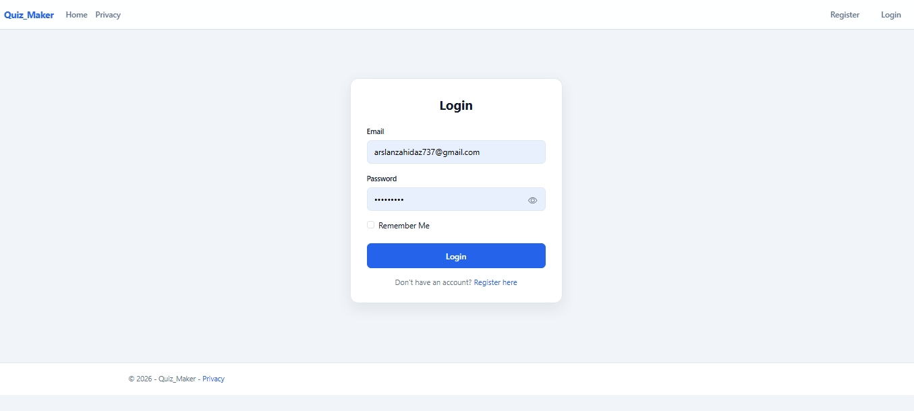
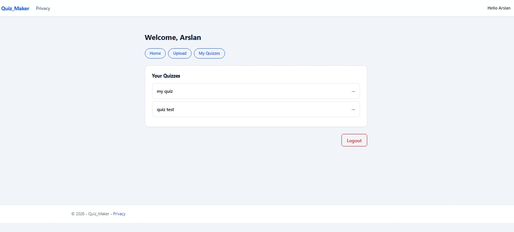
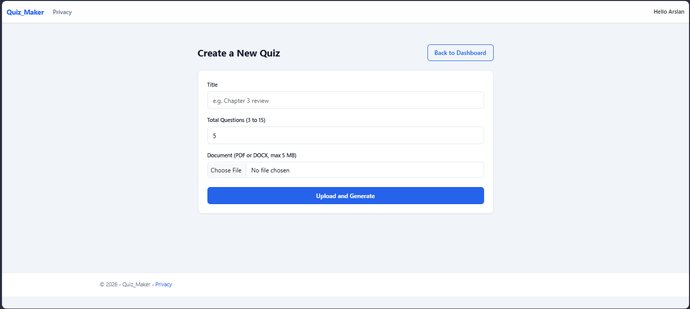
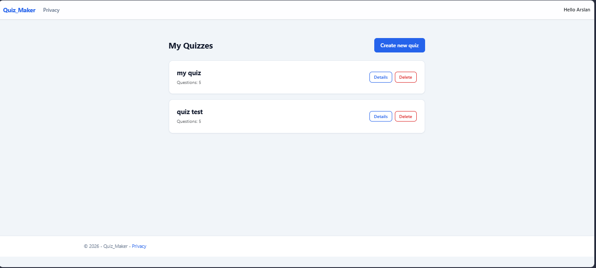
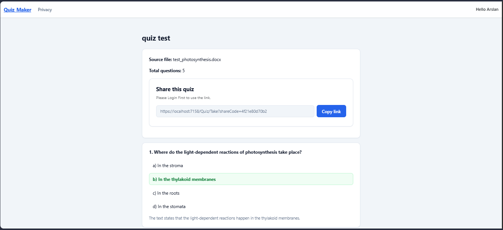
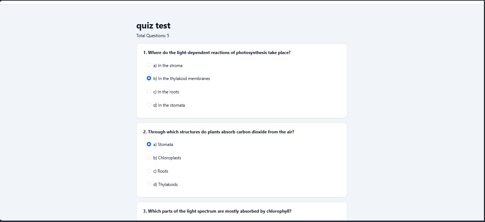
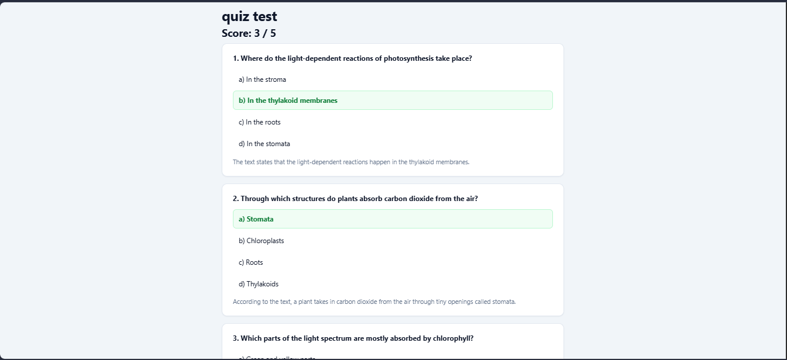

# Quiz Maker

An ASP.NET Core MVC web app that turns a PDF or DOCX document into a multiple-choice quiz using the Gemini AI API. Each quiz gets a share link. Other users log in, take the quiz, and see their score with explanations.

## Features

- **Authentication:** Register and login using ASP.NET Core Identity, with account lockout and antiforgery protection.
- **Dashboard:** After login, shows your quizzes and links to Upload, My Quizzes, and Logout.
- **Document upload:** Accepts PDF and DOCX files up to 5 MB.
- **Text extraction:** Extracts text from the document. Text longer than 30,000 characters is cut, and a warning is shown.
- **AI generation:** Uses Gemini to generate 3 to 15 multiple-choice questions, each with a correct answer and an explanation.
- **Quiz details:** Shows all questions, correct answers, explanations, and a share link with a copy button.
- **Take quiz:** Users open the share link and answer the questions (login required).
- **Result page:** Shows the score, each answer marked correct or wrong, and the explanation.
- **Attempts:** Every submission and its score is saved in the database.
- **My Quizzes:** Lists your quizzes with Details and Delete actions. Only the owner can delete a quiz.

## Tech Stack

- ASP.NET Core MVC (.NET 10)
- Entity Framework Core
- SQL Server
- ASP.NET Core Identity
- Gemini API
- Bootstrap 5, with custom CSS and JavaScript in `wwwroot`

## Project Structure

```
Quiz Maker/
├── Controllers/     AccountController (login, register, logout)
│                    QuizController (upload, dashboard, my quizzes, details, take, submit, delete)
├── Models/          Quiz, Question, Option, Attempt, ApplicationUser
├── ViewModel/       LoginViewModel, QuizResultViewModel
├── Services/        Document text extraction and Gemini quiz generation
├── Views/           Razor views
└── wwwroot/
    ├── css/site.css Custom styles
    └── js/          upload.js (form validation), myquizzes.js (delete confirmation)
```

## Getting Started

### Prerequisites

- .NET 10 SDK
- SQL Server (LocalDB or Express)
- Visual Studio 2026 or VS Code
- A Gemini API key

### Setup

1. Clone the repository:
```bash
   git clone https://github.com/Arslan-32005/Quiz-Maker.git
   cd Quiz-Maker
```

2. Store your Gemini API key in user secrets. Never commit the key:
```bash
   dotnet user-secrets set "Gemini:ApiKey" "YOUR_API_KEY"
```

3. Check the SQL Server connection string in `appsettings.json`.

4. Create the database:
```bash
   dotnet ef database update
```

5. Run the app:
```bash
   dotnet run
```
   Or press F5 in Visual Studio, then open `https://localhost:<port>`.

## How to Use

1. Register a new account. You will land on the Dashboard.
2. Go to **Upload**. Enter a title, the number of questions (3 to 15), and select a PDF or DOCX file.
3. After generation, the **Details** page shows the questions, correct answers, and the share link.
4. Copy the share link and send it to another user. They must log in to take the quiz.
5. After submitting, the **Result** page shows the score and each answer with its explanation.

## Screenshots

| Page | Preview |
|------|---------|
| Login |  |
| Dashboard |  |
| Upload |  |
| My Quizzes |  |
| Details |  |
| Take Quiz |  |
| Result |  |

## Known Limitations

- Only logged-in users can take a quiz. Guest attempts are not supported yet.
- There is no public/private toggle. Anyone with the share link can open a quiz.
- The free attempt limit is not implemented yet.

## Security Notes

- The Gemini API key is kept in user secrets (local) or environment variables (deployment), never in source control.
- Passwords are hashed by ASP.NET Core Identity.
- Forms use antiforgery tokens, and quiz ownership is checked on Details and Delete.

## Deployment

The app currently runs locally. Planned deployment: Azure App Service with Azure SQL Database. The live link will be added here once deployed.

## Author

**Arslan Zahid**
Computer Science student, Minhaj University, Lahore
[GitHub](https://github.com/Arslan-32005) · [LinkedIn](https://linkedin.com/in/arslan-zahid01)